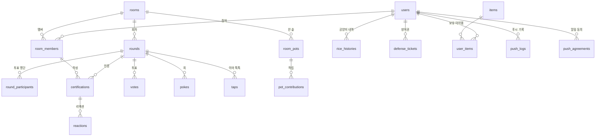

# 참아보살 ERD

| 항목 | 내용 |
|---|---|
| 작성일 | 2026-11-03 |
| 버전 | v0.2 (기획 답변 반영, 차단·신고 제거) |
| 기준 | [`docs/spec/`](README.md) 기능 명세 |
| DB | MySQL 8, 테이블·컬럼 `snake_case` |

> 모든 테이블은 `BaseEntity`의 `created_at`, `updated_at`을 가진다 (표에서는 생략).
> ❓ 표시는 [`open-questions.md`](open-questions.md) 결과에 따라 바뀔 수 있는 부분.
> ⚠️ 프론트 협의 필요 표시는 프론트와 정해야 바뀌는 부분.
> enum은 DB에 문자열(`VARCHAR`)로 저장한다 (`@Enumerated(EnumType.STRING)`).

---

## 1. 전체 구조

### 설계 원칙

- **사용자(`users`)와 방 안의 보살(`room_members`)을 나눈다.** 닉네임·색상·인증·투표는 모두 `room_members` 기준
- **공양미·방어권·꾸미기는 사용자 단위** (방 2개 합산)
- 나간 지 6개월 안에 다시 들어오면 예전 멤버 행을 다시 써서 지난 기록이 내 닉네임 그대로 보인다 (기획 확정). 6개월이 지나서 오면 새 행을 만들고, 돌아오지 않은 사람의 기록은 "떠난 보살"로 보인다
- 그래서 연속 지목·휴식도 `room_members`에 둔다 → 6개월 안에 나갔다 들어오면 이어짐
- 지목 횟수처럼 회차 결과에서 계산할 수 있는 값은 따로 저장하지 않고 조회할 때 집계한다 (월 단위, 방 최대 4명이라 부담 적음)

---

## 2. 사용자

### users

| 컬럼 | 타입 | 제약 | 설명 |
|---|---|---|---|
| id | BIGINT | PK | |
| toss_anon_key | VARCHAR(255) | UK, NULL | 앱인토스 익명 사용자 식별키 (API 필드 `anonKey`). 정리된 사용자는 NULL. 나중에 토스 로그인을 붙이면 `toss_user_key`를 옆에 추가 |
| is_poke_push_enabled | BOOLEAN | NOT NULL, 기본 true | 설정 > 콕 알림 |
| is_activity_push_enabled | BOOLEAN | NOT NULL, 기본 true | 설정 > 인증·투표 알림 |
| deleted_at | DATETIME | NULL | 내 데이터 삭제 시각. 6개월 안에 같은 `toss_anon_key`로 돌아오면 기존 사용자로 복구, 6개월이 지나면 행은 남기고 키를 비운 뒤 신규 사용자로 처리 |

- 알림 토글(`is_*_push_enabled`)은 토스 알림 동의와 별개인 앱 안 설정. 실제 발송 조건: `CERT_REMINDER`는 `push_agreements` 동의 **그리고** 인증·투표 알림 토글 `true` / 나머지는 해당 토글만 `true`면 발송
  - 사용자가 토스 앱 설정(서비스별 알림)에서 끄면 서버는 알 수 없음 → 발송 응답의 `fail`로만 확인

### push_agreements

토스 알림 동의는 기능성 캠페인(템플릿)마다 따로 받음 → 알림 종류별로 저장

| 컬럼 | 타입 | 제약 | 설명 |
|---|---|---|---|
| id | BIGINT | PK | |
| user_id | BIGINT | FK users, NOT NULL | |
| type | VARCHAR(30) | NOT NULL | `POKE` / `CERT_REMINDER` / `VOTE_OPENED` / `VOTE_REMINDER` / `RESULT` (`push_logs.type`과 같은 값) |
| agreed_at | DATETIME | NOT NULL | 동의 시각 (`newAgreement` / `alreadyAgreed` 결과를 클라이언트가 전달) |

- `UNIQUE (user_id, type)`. 행이 있으면 동의, 거부(`agreementRejected`)면 행을 만들지 않음
- 동의문이 필요 없는 템플릿으로 판정되면 그 종류는 행 없이 발송
- 동의는 인증 마감 리마인드(`CERT_REMINDER`) 1종만 받음. 나머지는 동의문 없는 기능성 메시지로 발송 (⏳ 앱인토스 채널톡 확인 중)
- 공양미 잔액은 컬럼으로 두지 않고 `rice_histories` 합계로 계산 (정책서 구현 메모)
  - 조회가 잦으면 나중에 `rice_balance` 캐시 컬럼 추가 검토

---

## 3. 방

### rooms

| 컬럼 | 타입 | 제약 | 설명 |
|---|---|---|---|
| id | BIGINT | PK | |
| name | VARCHAR(12) | NOT NULL | 방 이름, 수정 불가 |
| goal | VARCHAR(20) | NOT NULL | `DELIVERY` / `CAFE` / `SHOPPING` / `ETC` |
| member_limit | TINYINT | NOT NULL | 함께할 인원 2~4명, 수정 불가 |
| owner_member_id | BIGINT | FK room_members, NULL | 방장. 생성 직후 닉네임 정하기 전에는 NULL. [미정] Q-37 |
| pot_completed_count | INT | NOT NULL, 기본 0 | 쌀가마 배지 (🌾×n) |
| deleted_at | DATETIME | NULL | 마지막 멤버가 나가거나 빈 방 정리로 삭제 |

- 방 인원 수는 `room_members`에서 `left_at IS NULL`인 행 수로 계산

### room_members

| 컬럼 | 타입 | 제약 | 설명 |
|---|---|---|---|
| id | BIGINT | PK | |
| room_id | BIGINT | FK rooms, NOT NULL | |
| user_id | BIGINT | FK users, NULL | 내 데이터 삭제 후 6개월이 지나면 연결을 끊음 (NULL) |
| nickname | VARCHAR(8) | NOT NULL | 방 안 닉네임 |
| color | VARCHAR(20) | NOT NULL | `PINK` / `PURPLE` / `MINT` / `YELLOW`. 들어올 때 방 멤버가 안 쓰는 색 중 랜덤. 기본보살은 인증 작성 화면에서만 쓰는 고정 이미지라 저장 안 함 (기획 확정) |
| joined_at | DATETIME | NOT NULL | 방장 위임 순서("가장 먼저 들어온 멤버") 기준. 다시 들어오면 새로 기록 |
| left_at | DATETIME | NULL | 나간 시각. NULL이면 현재 멤버 |
| leave_type | VARCHAR(20) | NULL | `LEFT` / `KICKED` / `DATA_DELETED` |
| invite_token | VARCHAR(64) | UK, NULL | 초대 링크 토큰. 처음 공유할 때 만들고 계속 재사용 (공유 전에는 NULL) |
| seen_result_round_date | DATE | NULL | 결과 발표를 마지막으로 본 회차 날짜 |
| seen_pot_count | INT | NOT NULL, 기본 0 | 한 솥 축하를 몇 번째 솥까지 봤는지 |
| picked_streak | INT | NOT NULL, 기본 0 | 연속 지목 (방어 성공 포함). 다른 사람 지목·모두 무사·모두 보살·휴식 종료 시 0 |
| resting_round_date | DATE | NULL | 휴식할 회차 날짜. 3연속이 되면 다음 회차 날짜 지정 → 그 회차 투표에서 후보 제외. 회차 행이 아직 없어도 되도록 FK 대신 날짜로 저장 |

- 나간 지 6개월 안에 다시 들어오면 예전 행을 다시 씀: `left_at`·`leave_type`을 비우고 `joined_at`을 새로 기록
  - 이번 달 지목 횟수는 저장하지 않고 `rounds`에서 집계 (`picked_user_id` + 회차 월 + `result_type = PICKED`)
  - 다시 들어올 때 닉네임 입력(WF 03)에 예전 닉네임을 기본값으로 채워 보여주고 그대로 쓰거나 수정 (기획 확정). 예전 닉네임은 다른 사람이 못 쓰는 값이라 겹치지 않고, 중복 검사에서 본인 행은 제외
  - 색이 겹치면 남은 색 중 랜덤 (기획 확정). 색을 먼저 정하고 `left_at`을 비움 (먼저 비우면 UNIQUE에 막힘)
  - 나간 지 6개월이 지나서 오면 새 멤버로 새 행을 만듦 (기획 확정). 지목 통계는 0부터 시작하고 예전 행은 "떠난 보살"로 남음
- 현재 멤버와 6개월 안에 나간 멤버의 닉네임은 쓸 수 없음 (대소문자 무시, 기획 확정)
  - 6개월 조건은 UNIQUE로 걸 수 없어서 `rooms` 행 락을 잡고 서비스에서 확인 (입장·닉네임 변경 모두). 현재 멤버끼리는 아래 UNIQUE로도 막음
  - 🛠 MySQL은 부분 인덱스가 없음 → 생성 컬럼 `active_nickname = IF(left_at IS NULL, LOWER(nickname), NULL)`에 `UNIQUE (room_id, active_nickname)`
- 현재 멤버 중 같은 사람은 한 번만: 같은 방식으로 `UNIQUE (room_id, active_user_id)`
- 현재 멤버 중 색상 중복 불가: 같은 방식으로 `UNIQUE (room_id, active_color)`
- 내보내진 사람 판단: `leave_type = 'KICKED'`인 행이 (room_id, user_id)에 있는지
- 인덱스: `(room_id, left_at)` → 방의 현재 멤버 목록·인원 수 / `(user_id, left_at)` → 내가 참여 중인 방 목록·개수
  - 인원 수는 컬럼으로 저장하지 않고 매번 셈 (방당 최대 4명이라 인덱스로 몇 행만 읽음)
  - 동시 입장으로 `member_limit`을 넘지 않게 입장할 때 `rooms` 행에 락(`SELECT ... FOR UPDATE`) 후 인원 확인. 방 2개 제한도 같은 이유로 `users` 행에 락
- 참여 중인 방 개수: user_id 기준 `left_at IS NULL` 행 수 (삭제된 방 제외)
- 초대 링크: `Share.createLink({ path: "intoss://{앱이름}/invite?token={invite_token}" })`
  - 링크로 들어오면 토큰으로 멤버를 찾고, 그 멤버의 `room_id`·`nickname`으로 미리보기("{닉네임} 님의 초대")
  - 멤버당 1개라 별도 테이블 없이 컬럼으로 둠. 만료·링크 여러 개가 필요해지면 테이블로 분리
  - 만료는 방이 삭제될 때 (기획 확정). 만료 컬럼은 따로 없음. 6개월 안에 다시 들어오면 같은 행이라 토큰도 그대로, 지나서 오면 새 행이라 토큰도 새로 생김
  - 초대한 사람이 나갔을 때: 스스로 나감 → 링크 유지, 미리보기에 이름 없이 표시 / 내보내짐 → 링크 막음 (기획 확정)
- 확인 여부 (결과 발표·한 솥 축하): 정책이 "안 본 것 중 최근 1개만, 한 번만"이라 회차별 기록 대신 "어디까지 봤는지" 값 하나로 처리
  - 결과: 가장 최근 발표된 회차 날짜 > `seen_result_round_date`이면 결과 화면 표시 · 투표 탭 "결과 미확인" · 빨간 점 · 결과 알림 대상. 보면 그 회차 날짜로 업데이트
  - 한 솥: `rooms.pot_completed_count > seen_pot_count`이면 축하 화면 표시 · 빨간 점. 보면 클라이언트가 본 완성 횟수로 업데이트 (저장값보다 클 때만, ROOM-06)
  - **방에 들어올 때 두 값을 현재 상태로 채움** (들어오기 전 결과·축하가 뜨지 않게). 다시 들어올 때도 같은 처리
  - "누가 언제 봤는지" 기록은 남지 않음. 분석이 필요해지거나 "안 본 결과 전부 보여주기"로 정책이 바뀌면 테이블로 분리

---

## 4. 회차 · 인증

### rounds

| 컬럼 | 타입 | 제약 | 설명 |
|---|---|---|---|
| id | BIGINT | PK | |
| room_id | BIGINT | FK rooms, NOT NULL | |
| round_date | DATE | NOT NULL | 회차 날짜 (KST, 05:00부터 다음 날 04:59까지) |
| status | VARCHAR(20) | NOT NULL | `CERTIFYING` / `VOTING` / `ANNOUNCED` / `NO_VOTE` |
| vote_started_at | DATETIME | NULL | 전원 인증 시각 또는 다음 날 05:00. `NO_VOTE`로 확정되면 그 확정 시각을 기록해 사진 삭제 기준으로 사용. 마지막 인증자의 방어권 유예(투표 시작 후 1~2분) 판단에도 사용 |
| vote_closed_at | DATETIME | NULL | 투표권 있는 명단 전원 투표 시각 또는 다음 회차 투표 시작 시각 |
| result_type | VARCHAR(20) | NULL | `PICKED` / `ALL_BOSAL` / `ALL_SAFE` / `DEFENDED` |
| picked_member_id | BIGINT | FK room_members, NULL | 지목된 멤버 (`PICKED`, `DEFENDED`) |
| picked_user_id | BIGINT | FK users, NULL | 지목 횟수 집계용 (멤버가 나가도 유지) |
| version | BIGINT | NOT NULL | 낙관적 락 (배치와 이벤트가 동시에 상태를 바꾸는 것 방지) |

- `UNIQUE (room_id, round_date)`
- 회차 행은 그날 방에서 첫 인증이나 첫 콕이 있을 때 만든다 (ROOM-02, POKE-01)
  - 인증도 콕도 없던 날은 회차 행이 없다. 그 회차는 인증한 사람이 0명이므로 다음 날 05:00 처리는 VOTE-01 4번(인증 0명, [미정] Q-57)을 따르고, 투표를 열기로 정하면 그때 행을 만든다
  - 이전 회차 투표 닫기(VOTE-04 2번)는 다음 회차 행이 있는지와 상관없이 05:00에 한다
- 득표수는 `votes`에서 집계
- `version` (낙관적 락): JPA 엔티티 필드에 `@Version`만 붙이면 저장할 때마다 version을 올리고, 읽었을 때와 값이 다르면 저장을 실패시켜 줌 (`OptimisticLockException`)
  - 예) 04:59:59 마지막 인증(이벤트)과 05:00 배치가 같은 회차를 동시에 투표 시작 → 먼저 저장한 쪽만 성공, 나중 쪽은 실패 → "이미 처리됨"으로 보고 넘어감
  - 투표 마감(전원 투표 이벤트 vs 다음 회차 투표 시작)도 같은 방식. 없으면 명단 스냅샷·알림·결과 판정·공양미 지급이 두 번 일어날 수 있음

### round_participants

투표 시작 시점의 명단 스냅샷

| 컬럼 | 타입 | 제약 | 설명 |
|---|---|---|---|
| id | BIGINT | PK | |
| round_id | BIGINT | FK rounds, NOT NULL | |
| member_id | BIGINT | FK room_members, NOT NULL | |
| is_candidate | BOOLEAN | NOT NULL | 후보 여부 (그날 들어와서 인증 안 함·휴식 중이면 false) |
| can_vote | BOOLEAN | NOT NULL | 투표권. 투표 시작 시점까지 인증했으면 true (11/8 회의) |
| is_resting | BOOLEAN | NOT NULL | 휴식 중 (후보 카드에 흐리게 표시) |
| moktak_count | INT | NOT NULL | 투표 시작 시점 목탁 수 (후보 카드·동점 판정) |

- `UNIQUE (round_id, member_id)`
- 명단 3명 미만이면 행을 만들지 않고 `rounds.status = NO_VOTE`

### certifications

| 컬럼 | 타입 | 제약 | 설명 |
|---|---|---|---|
| id | BIGINT | PK | |
| round_id | BIGINT | FK rounds, NOT NULL | |
| member_id | BIGINT | FK room_members, NOT NULL | |
| result | VARCHAR(20) | NOT NULL | `ENDURED`(참았어요) / `FAILED`(못 참았어요) |
| memo | VARCHAR(40) | NULL | 한 줄 기록. 6개월 정리 때 NULL |
| spent_amount | INT | NULL | 쓴 금액, `FAILED`일 때 필수 (1~999,999) |
| image_key | VARCHAR(255) | NULL | 인증 사진 S3 객체 키. presigned PUT URL로 업로드 후 키만 저장, 조회는 응답할 때마다 presigned GET URL 생성 (URL은 만료되므로 저장 안 함) |
| image_deleted_at | DATETIME | NULL | 사진 삭제 시각 (투표 끝나고 7일 뒤 · 내 데이터 삭제 즉시) |
| certified_at | DATETIME | NOT NULL | 수정 가능 10분 기준 |
| deleted_at | DATETIME | NULL | 소프트 삭제 (10분 안 본인 삭제) |

- 활성 인증은 회차당 1개: 생성 컬럼 `active_member_id = IF(deleted_at IS NULL, member_id, NULL)`에 `UNIQUE (round_id, active_member_id)`
- 잠금 여부는 저장하지 않고 계산: `certified_at + 10분 < 지금` 또는 `rounds.status != CERTIFYING`
- 사진 업로드: presigned PUT URL은 S3 임시 경로(`tmp/`)로 발급 → 인증 등록 때 정식 경로로 옮기고 그 키를 `image_key`에 저장
  - 업로드만 하고 인증까지 안 간 사진(마지막 인증 확인 시트에서 취소·이탈 등)은 `tmp/`에 남음 → S3 수명 주기 규칙으로 하루 뒤 자동 삭제 (정리 배치·테이블 불필요)

### reactions

| 컬럼 | 타입 | 제약 | 설명 |
|---|---|---|---|
| id | BIGINT | PK | |
| certification_id | BIGINT | FK certifications, NOT NULL | |
| member_id | BIGINT | FK room_members, NOT NULL | 누른 사람 |
| type | VARCHAR(20) | NOT NULL | `RICE`(잘 참았다) / `MOKTAK`(아쉬워요) |

- `UNIQUE (certification_id, member_id)` → 변경은 type 수정, 취소는 행 삭제

### pokes

| 컬럼 | 타입 | 제약 | 설명 |
|---|---|---|---|
| id | BIGINT | PK | |
| round_id | BIGINT | FK rounds, NOT NULL | |
| from_member_id | BIGINT | FK room_members, NOT NULL | |
| to_member_id | BIGINT | FK room_members, NOT NULL | |
| count | INT | NOT NULL | 연타 누적 ("콕 ×12"는 받은 사람 기준 합계) |

- `UNIQUE (round_id, from_member_id, to_member_id)` → 누를 때마다 count +1
- 받은 사람이 인증하면 그 회차의 받은 콕 행을 삭제(초기화)할지는 [미정] Q-54 (11/8 회의로 인증한 멤버도 콕을 받음)
- ⚠️ 프론트 협의 필요: 앱 안에서 무제한 연타 가능 → 누를 때마다 API를 부르지 말고 1~2초 모아서 한 번에 전송 (예: `{ count: 5 }`), 서버는 count에 더함

---

## 5. 투표 · 결과

### votes

| 컬럼 | 타입 | 제약 | 설명 |
|---|---|---|---|
| id | BIGINT | PK | |
| round_id | BIGINT | FK rounds, NOT NULL | |
| voter_member_id | BIGINT | FK room_members, NOT NULL | |
| target_member_id | BIGINT | FK room_members, NULL | NULL이면 "오늘은 모두 보살" |

- `UNIQUE (round_id, voter_member_id)` → 1인 1표, 변경 불가
- 투표 마감 전에 나간 멤버가 이미 낸 표는 집계에 포함 (기획 확정). 컬럼 추가 없음
- 투표하지 않고 나간 멤버는 기권. 전원 투표 조기 마감은 남은 명단 멤버 기준으로 판단 (기획 확정)
- 마감 전 재입장자는 이번 회차 투표 불가 (기획 확정): `joined_at > vote_started_at`으로 판단. 이미 낸 표는 유지
- 본인 투표 금지·후보 여부는 서비스에서 `round_participants`로 검증

### taps (이마 톡톡)

| 컬럼 | 타입 | 제약 | 설명 |
|---|---|---|---|
| id | BIGINT | PK | |
| round_id | BIGINT | FK rounds, NOT NULL | |
| from_member_id | BIGINT | FK room_members, NOT NULL | 두드린 사람 |
| count | INT | NOT NULL | 0~10 |
| played_at | DATETIME | NULL | 받은 사람 화면에서 재생된 시각. NULL이면 아직 안 본 톡톡 → 다음에 열 때 재생 |

- `UNIQUE (round_id, from_member_id)` → 1인 회차당 1세트
- 받는 사람(지목된 사람)은 `rounds.picked_member_id`라 따로 저장하지 않음
- 톡톡이 끝날 때(10번 다 침·건너뛰기·나가기) 프론트가 최종 횟수를 **한 번만** 보냄 → 행이 생겼다는 것 자체가 끝났다는 뜻 (UNIQUE라 두 번째 요청은 거절)
  - "친구 n명이 톡톡했어요" = 그 회차에서 count가 1 이상인 행 개수 (나 제외). 0번 건너뛰기도 행은 만듦 (다시 못 치게)
  - 톡톡 도중 앱이 강제로 꺼지면 전송을 못 해서 그 사람의 톡톡은 전달 안 됨 (벌칙 연출이라 감수)
- ⚠️ 프론트 협의 필요: 칠 때마다 보내지 말고 끝날 때 `{ count: n }` 한 번만 전송. 화면을 나갈 때(`pagehide` 등)도 친 만큼 전송

---

## 6. 공양미 · 한 솥

### rice_histories (공양미 내역)

| 컬럼 | 타입 | 제약 | 설명 |
|---|---|---|---|
| id | BIGINT | PK | |
| user_id | BIGINT | FK users, NOT NULL | |
| delta | INT | NOT NULL | +10, +5, +30, -50, -100, -10 … |
| reason | VARCHAR(20) | NOT NULL | `CERTIFICATION` / `VOTE` / `POT` / `PURCHASE` / `RECALL` |
| ref_type | VARCHAR(20) | NULL | `CERTIFICATION` / `VOTE` / `ROOM_POT` / `ITEM` / `DEFENSE` |
| ref_id | BIGINT | NULL | 원인 행 ID |

- 잔액 = `SUM(delta) WHERE user_id = ?`, 음수 허용
- 중복 지급 방지: `UNIQUE (user_id, reason, ref_type, ref_id)`
  - 인증 보상은 인증 ID 기준이라 삭제 후 다시 인증하면 새 ID로 다시 지급 (기획 확정)
  - 회수(`RECALL`)도 같은 인증 ID로 1번만

### room_pots (한 솥)

| 컬럼 | 타입 | 제약 | 설명 |
|---|---|---|---|
| id | BIGINT | PK | |
| room_id | BIGINT | FK rooms, NOT NULL | |
| seq | INT | NOT NULL | 몇 번째 솥인지 (1부터) |
| amount | INT | NOT NULL, 기본 0 | 현재 진행도 (0~300) |
| carried_over | INT | NOT NULL, 기본 0 | 이전 솥에서 넘어온 석 |
| completed_at | DATETIME | NULL | 가득 찬 시각. NULL이면 진행 중인 솥 |

- `UNIQUE (room_id, seq)`. 진행 중인 솥은 방마다 1개
- 가득 차면 `completed_at` 기록 → 멤버 전원 `rice_histories`에 `POT` +30 → `rooms.pot_completed_count` +1 → 다음 솥을 넘친 석으로 생성

### pot_contributions

| 컬럼 | 타입 | 제약 | 설명 |
|---|---|---|---|
| id | BIGINT | PK | |
| pot_id | BIGINT | FK room_pots, NOT NULL | 들어간 솥 |
| member_id | BIGINT | FK room_members, NOT NULL | |
| delta | INT | NOT NULL | +10 / +5 / -10 |
| reason | VARCHAR(20) | NOT NULL | `CERTIFICATION` / `VOTE` / `RECALL` |
| ref_id | BIGINT | NOT NULL | 인증 또는 투표 ID |

- 인증이 지워질 때: 그 인증이 들어간 솥이 `completed_at IS NULL`이면 차감 (0 아래로는 안 내려감), 이미 찬 솥이면 차감 안 함
- 넘쳐서 두 솥에 나뉘어 들어간 경우는 🛠 가득 찬 솥 기준으로 기록 (이미 보상이 나갔으니 차감 대상 아님)

---

## 7. 곳간

### defense_tickets (이마 방어권)

| 컬럼 | 타입 | 제약 | 설명 |
|---|---|---|---|
| id | BIGINT | PK | |
| user_id | BIGINT | FK users, NOT NULL | |
| purchased_at | DATETIME | NOT NULL | |
| used_at | DATETIME | NULL | NULL이면 보유 중 |
| used_round_id | BIGINT | FK rounds, NULL | 쓴 회차 (방은 회차에서 알 수 있음) |
| used_week_start | DATE | NULL | 쓴 회차 날짜가 속한 주의 월요일 |

- 최대 1개 보유: 생성 컬럼 `unused_user_id = IF(used_at IS NULL, user_id, NULL)`에 UNIQUE
- 주 1번: `UNIQUE (user_id, used_week_start)`
- 사용 조건(그 방 인증 완료, 투표 시작 전, 휴식 중 아님, 방 3명 이상)은 서버에서 검증. 예외: 마지막 인증자는 투표 시작 후 1~2분 안에 본인만 사용 가능 (기획 확정)
- 결과 판정 때 지목된 사람의 `used_round_id = 이 회차`인 방어권이 있으면 `DEFENDED`

### items (꾸미기 카탈로그)

| 컬럼 | 타입 | 제약 | 설명 |
|---|---|---|---|
| id | BIGINT | PK | |
| code | VARCHAR(50) | UK, NOT NULL | `RUDOLPH_NOSE` 등, 클라이언트 이미지 매핑 |
| name | VARCHAR(20) | NOT NULL | |
| price | INT | NOT NULL | 50 / 100 |
| slot | VARCHAR(20) | NOT NULL | `HAT` / `FACE` / `EXPRESSION` |
| display_order | INT | NOT NULL | 상점 노출 순서 |

- 6종으로 시작 (정책서상 "예시"라 바뀔 수 있어서 enum 대신 테이블)

### user_items

| 컬럼 | 타입 | 제약 | 설명 |
|---|---|---|---|
| id | BIGINT | PK | |
| user_id | BIGINT | FK users, NOT NULL | |
| item_id | BIGINT | FK items, NOT NULL | |
| is_equipped | BOOLEAN | NOT NULL, 기본 false | 착용 중 여부 |

- `UNIQUE (user_id, item_id)` → 영구 보유
- 슬롯마다 하나만 착용: 착용할 때 같은 `items.slot`의 다른 보유 아이템을 `false`로 바꿈
- 슬롯이 늘어나면 `items.slot` 값만 추가, 테이블 구조는 그대로
- 착용은 모든 방 공통 (기획 확정)

---

## 8. 알림

### push_logs

| 컬럼 | 타입 | 제약 | 설명 |
|---|---|---|---|
| id | BIGINT | PK | |
| user_id | BIGINT | FK users, NOT NULL | 받는 사람 |
| type | VARCHAR(30) | NOT NULL | `POKE` / `CERT_REMINDER` / `VOTE_OPENED` / `VOTE_REMINDER` / `RESULT` |
| room_id | BIGINT | FK rooms, NULL | 인증 마감 리마인드(`CERT_REMINDER`)는 방 개수와 상관없이 항상 NULL |
| round_date | DATE | NOT NULL | |
| is_success | BOOLEAN | NOT NULL | 앱인토스 응답 결과 |

- 중복 발송 방지 (콕 푸시 회차당 1번 등): 생성 컬럼 `room_key = IFNULL(room_id, 0)`에 `UNIQUE (user_id, type, room_key, round_date)`
  - `room_id`에 바로 UNIQUE를 걸면 MySQL은 NULL끼리 같은 값으로 보지 않아서, 방 2개를 합친 인증 리마인드(`room_id` NULL)가 두 번 들어가도 못 막음
  - 발송 실패(`is_success = false`) 후 다시 보낼 때는 새 행을 넣지 말고 기존 행을 업데이트 (새로 넣으면 UNIQUE에 막힘)

---

## 인덱스 정리

UNIQUE 제약은 자동으로 인덱스가 생기므로 따로 적지 않음. 아래는 조회용으로 추가로 거는 인덱스.

| 테이블 | 인덱스 | 쓰이는 곳 |
|---|---|---|
| `room_members` | `(room_id, left_at)` | 방의 현재 멤버 목록·인원 수 (오늘 탭, 입장 시 `member_limit` 확인) |
| `room_members` | `(user_id, left_at)` | 내가 참여 중인 방 목록·개수 (내 보살 탭, 방 2개 제한) |
| `certifications` | `(member_id)` | 이번 달 참은 횟수·연속 인증·인증 캘린더 (멤버 → 사용자 기준 집계) |
| `rounds` | `(status, round_date)` | 05:00 배치가 처리할 회차 찾기 (인증 중·투표 중인 회차) |

---

## 9. 데이터 정리 규칙

| 대상 | 시점 | 처리 |
|---|---|---|
| 인증 사진 | 회차 투표 종료 + 7일 (`NO_VOTE` 회차는 확정 시각(`vote_started_at`) + 7일, 삭제된 방의 마감되지 않은 회차는 방 삭제 시각 + 7일) | 파일 삭제, `image_deleted_at` 기록 |
| 나간·내보내진 멤버의 사진 | 일반 사진과 같음 (나가도 즉시 삭제 안 함) | 같은 방식 |
| 나간·내보내진 멤버의 사진·한 줄·금액 | `left_at` + 6개월 | 남은 사진 삭제, `memo`, `spent_amount` NULL. 투표 결과는 "떠난 보살"로 유지 |
| 내 데이터 삭제 | 즉시 | 모든 방 나가기 (`leave_type = DATA_DELETED`), 사진 즉시 삭제, 기록은 바로 "떠난 보살"로 표시. `users` 행은 6개월 보관. 그 안에 돌아오면 공양미·아이템·방어권 그대로 (기획 확정) |
| 내 데이터 삭제 후 6개월 | `deleted_at` + 6개월 | `users` 행은 남기고 `toss_anon_key` NULL, `room_members.user_id` NULL → 이후 같은 키로 오면 신규 사용자 |
| 빈 방 | 매일, 만든 지 24시간 지난 방 | 현재 멤버 0명인 방 `deleted_at` 기록 ([미정] Q-37) |
| 인증에 안 쓰인 업로드 사진 | 업로드 + 1일 | S3 `tmp/` 경로 수명 주기 규칙으로 자동 삭제 (서버 작업 없음) |

---

## 10. 남은 결정 (요약)

| 항목 | 바뀌는 곳 |
|---|---|
| 동의문 없는 알림 범위 (⏳ 채널톡) | `push_agreements`에 저장할 알림 종류 |
